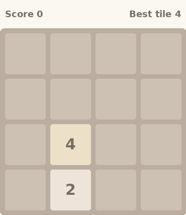

# 2048-AI

<p align="center">
  
  <br>
  <em>The final agent playing seed 0: it reaches 4096 with a score of 80,352.<br>
  Most of the game is sped up; the last 40 moves are shown one by one.</em>
</p>

An AI that plays 2048, trained with Deep Q-Learning (DQN), a form of reinforcement learning.
2048 is a sliding-tile puzzle where you merge equal-numbered tiles to create the 2048 tile.

**Result:** the final agent reaches the 2048 tile in **98% of games it has never seen**, and the 4096 tile in about half of them (mean score ~51,000).
It combines a neural network trained with DQN, which judges how good a board is, and an expectimax search that uses those judgments to plan up to four moves ahead.

## Read more

- **[Write-up](WRITE-UP.md):** how the agent went from never reaching 512 to reaching 2048 in 98% of games: what worked, what didn't, and what I learned.
- **[Appendix](APPENDIX.md):** every evaluation result, what each version changed, the final settings, and a glossary.


## Project structure

- `game.py`: the game itself, in Python, with a Tkinter GUI. Run it by itself to play with the keyboard.
- `environment.py`: the Gymnasium environment (observations, rewards, game over), built on `game.py`.
- `masked_dqn.py`: Stable-Baselines3's DQN, extended with action masking, Double DQN, and the search (in training and in play).
- `lookahead.py`: the expectimax search.
- `train.py`: trains a new model or continues training an existing one.
- `score_callback.py`: evaluates the model during training, to get learning curves.
- `evaluate.py`: plays 100 games and prints the results.
- `watch_ai.py`: watch the model play live in the GUI.
- `plot_runs.py`: draws the learning curves of several runs (`runs.png`).
- `make_figures.py`: draws the summary charts in `figures/` from results already measured.
- `make_gif.py`: records one game as an animated GIF.
- `model_files.py`: where each model's files are saved (`models/<name>/`).


## How to use

Requirements: Python 3, `stable-baselines3`, `gymnasium`, `torch`, `numpy`, `matplotlib`, `pillow`, `tqdm`, `rich` (and Tkinter for the GUI).

```bash
# Train (lookahead_v1: train_lookahead_depth=1 in train.py, 2M moves, then 1M more)
python train.py --model lookahead_v1 --steps 2000000 --seed 0 --eval-lookahead
python train.py --model lookahead_v1 --steps 1000000 --continue-training --eval-lookahead

# Evaluate (--lookahead 4 = adaptive 2-to-4-move search, ~3 min per game on CPU)
python evaluate.py --model lookahead_v1 --lookahead 4 --seed-offset 1000 --games 100 --per-game

# Watch it play
python watch_ai.py --model lookahead_v1 --lookahead 4

# Record one game as a GIF (figures/ai_playing.gif)
python make_gif.py --model lookahead_v1 --lookahead 4 --seed 0

# Learning curves
python plot_runs.py empty_v2 lookahead_v1 --lookahead
```

`--lookahead` takes 0 (network alone), 1, 2, 3 (2 to 3 moves) or 4 (2 to 4 moves).
`--seed-offset` sets the first game's seed, `--per-game` shows progress and each game's result.
